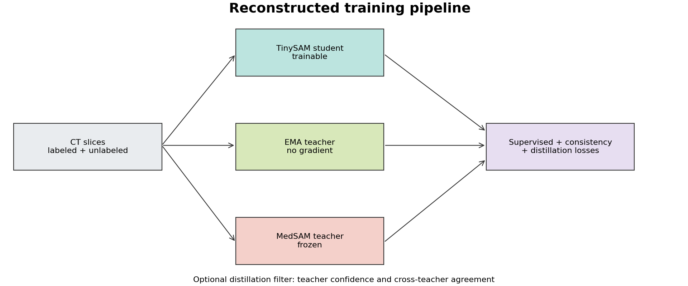
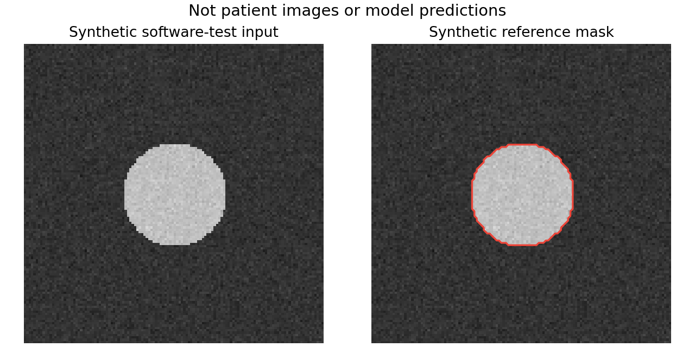

# ICH Segmentation: Mean Teacher and SAM Distillation

Reconstructed research code for binary intracranial hemorrhage segmentation in
CT slices. Combines a TinySAM student, an exponential-moving-average teacher,
and a frozen MedSAM teacher. Includes patient-disjoint data checks, paired
ablation runs, checkpoint selection on validation patients, and patient-level
test metrics.

**Status:** reconstructed implementation with synthetic execution checks.
Medical-data experiments remain to be run. See [implementation notes](docs/PROVENANCE.md).
Not for diagnosis or clinical deployment.



## Method

The student is trained on labeled slices with binary cross-entropy plus soft
Dice loss. An EMA copy produces predictions on noisy unlabeled slices; the
student is trained for probability consistency under a stronger intensity
perturbation. A frozen MedSAM ViT-B model supplies temperature-scaled Bernoulli
KL distillation targets using boxes derived from EMA predictions.

Unlabeled boxes never use reference masks. Empty proposals use a full-image box
for the forward pass but are excluded from distillation. Validation/test boxes
come from a first full-image prediction, not annotations. One box per slice may
merge multiple hemorrhage regions; lesion-wise prompts are not implemented.

The optional filter retains distillation pixels only when both teachers are at
least 0.8 confident and their binary predictions agree. It may amplify shared errors, suppress
small lesions, or select mostly background; inspect coverage and per-patient
recall. There is no guarantee it improves over unfiltered distillation.

## Install and test

```bash
python3 -m venv .venv
source .venv/bin/activate
python -m pip install --upgrade pip
pip install -e '.[dev]'
pytest -q
python -m ich.train --smoke --steps 5 --output runs/smoke
```

Smoke mode substitutes small convolutional models and generated circles for all
SAM models and CT data. It verifies loss/backpropagation, EMA, checkpointing and
evaluation flow; it does not test pretrained SAM quality.



## Real models

```bash
pip install -e '.[sam,baselines,dev]'
python scripts/fetch_upstream.py
# Obtain TinySAM and MedSAM ViT-B checkpoints from their official repositories.
python -m ich.train --manifest data/manifest.csv --mode combined \
  --tiny-checkpoint checkpoints/tinysam.pth \
  --medsam-checkpoint checkpoints/medsam_vit_b.pth \
  --device cuda --steps 10000 --output runs/combined
```

Weights are loaded strictly. Do not use a generic SAM checkpoint and label it
MedSAM. The TinySAM and MedSAM normalization paths are intentionally distinct;
verify them against the checkpoint release used. Native mode resizes slices
to 1024x1024 for pretrained image encoders. The optional `--adaptation 512`
instead reconstructs the discussed encoder handling: TinyViT first convolution
stride 2 to 1; ViT-B 32x32 patch embeddings interpolated to 64x64 before adding
the pretrained positional embedding. Prompt coordinates remain in the original
1024-coordinate embedding frame. This adaptation requires real-model testing
and accuracy comparisons before use in reported experiments.

`--backbone efficientnet --mode supervised` and `--mode mean_teacher` provide
EfficientNet-B2 U-Net baselines through segmentation-models-pytorch. Their
encoders start without ImageNet weights. `--backbone resnet` is an additional
ResNet18 U-Net baseline, not the historical plain U-Net architecture.

## Data contract

Use a CSV manifest with these columns:

```csv
patient_id,image,mask,split
p001,images/p001_001.npy,masks/p001_001.npy,train_labeled
p002,images/p002_001.npy,,train_unlabeled
p003,images/p003_001.npy,masks/p003_001.npy,val
p004,images/p004_001.npy,masks/p004_001.npy,test
```

Paths resolve relative to the manifest. Every patient belongs to exactly one
split. Use globally unique patient IDs across data sources and do not distribute
the same patient under different IDs. Unlabeled rows must have blank masks.
All slices from a patient must stay together. Use the same manifest across
baselines; matching random seeds alone does not guarantee matching splits.

Inputs are finite float32 CHW arrays with three pre-windowed CT channels in
[0,1], or a single windowed HW array repeated across channels. Reference masks
are binary HW arrays. Normalize from float32 HU data before saving, with
window settings recorded in your dataset documentation. This repository does
not guess original CT windows, infer dataset permissions, convert DICOM/NIfTI,
or recreate patient splits. Prepare these from authorized data independently.

## Ablations

Run all five configurations on the same patients and paired seeds:

| Mode | Supervised | EMA consistency | MedSAM distillation | Agreement filter |
| --- | --- | --- | --- | --- |
| `supervised` | yes | no | no | no |
| `mean_teacher` | yes | yes | no | no |
| `distill` | yes | no | yes | no |
| `combined` | yes | yes | yes | no |
| `filtered` | yes | yes | yes | yes |

The distill-only run still uses an EMA model to propose boxes, but has no EMA
consistency loss. Thus its comparison isolates the consistency objective, not
the presence of an EMA network. Add a fixed common proposal source if you need
to isolate teacher architecture from prompt quality.

```bash
# Fast execution checks only:
python scripts/ablations.py --smoke --steps 5 --seeds 17 29 43
# Real experiments (GPU and authorized data/checkpoints required):
python scripts/ablations.py --steps 10000 --seeds 17 29 43 \
  --manifest data/manifest.csv --tiny-checkpoint checkpoints/tinysam.pth \
  --medsam-checkpoint checkpoints/medsam_vit_b.pth --device cuda
```

Each run saves configuration and manifest hash, JSONL loss components and filter
coverage, the best validation checkpoint, and per-patient test Dice, precision,
recall, absolute relative volume difference and signed relative volume error.
Zero-reference-volume patients have undefined volume difference (`null`), not
an invented zero. Dice is 1 for empty prediction and empty reference.
Metrics aggregate voxel counts per patient, then macro-average patient Dice.
No physical voxel-volume correction is applied; inputs must preserve a common
voxel volume within each patient's evaluated slices for volume interpretation.

No real-data ablation results are available yet. Keep the test set locked while
choosing hyperparameters from validation only. Report every seed, uncertainty,
lesion-size sensitivity and filter coverage; do not cherry-pick test patients.

## Prediction comparisons

```bash
python scripts/compare.py --manifest data/manifest.csv \
  --runs runs/ablations/supervised_seed17 runs/ablations/combined_seed17 \
  --output runs/comparison --device cuda
```

Panels show the input CT slice, reference contours in red and prediction contours
in white, with per-slice Dice. Sampling follows manifest order rather than sorting
for favorable scores. Generated patient panels stay in the ignored `runs/` folder.

## Verification

- CPU unit/integration suite covering all five training modes.
- Fifteen synthetic runs: five modes, seeds 17/29/43, five optimization steps.
- TinySAM and ViT-B random-weight 512x512 forward-interface checks.
- Pretrained medical-data training and medical ablation results: pending.

Run the architecture checks after fetching upstream sources:

```bash
python scripts/check_sam_interfaces.py
```

## References and upstream code

- [SSL4MIS](https://github.com/HiLab-git/SSL4MIS), pinned by the setup script;
  Mean Teacher reference and runtime sigmoid ramp-up utility.
- [Mean Teacher](https://arxiv.org/abs/1703.01780).
- [TinySAM](https://github.com/xinghaochen/TinySAM), runtime model definitions.
- [MedSAM](https://github.com/bowang-lab/MedSAM), medical teacher checkpoint.

Upstream source and checkpoint licenses remain their authors' terms. No private
messages, patient images, clinical weights or historical results are uploaded.
