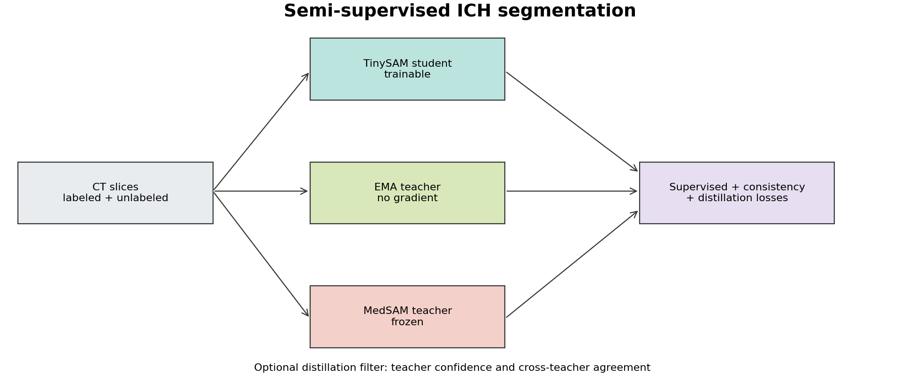
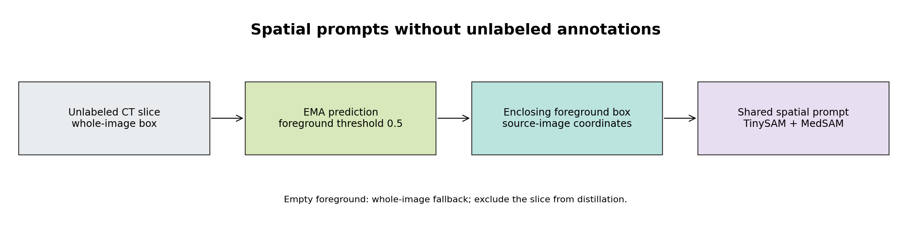

# Architecture



## Model roles

| Component | Architecture | Updated during training | Role |
| --- | --- | --- | --- |
| Student | TinySAM with TinyViT image encoder | Image encoder and mask decoder | Binary segmentation |
| EMA teacher | Copy of student | Weight averaging; matching buffers copied | Prompt proposals and consistency targets |
| Medical teacher | SAM ViT-B architecture with MedSAM checkpoint | Frozen | Distillation targets |

Prompt-encoder parameters are frozen. Both teachers execute without gradients.
The student image encoder and mask decoder are optimized jointly. The MedSAM
teacher uses the ViT-B architecture exposed by the pinned TinySAM registry;
checkpoint loading is strict and requires a compatible MedSAM state dictionary.

## Tensor flow

```text
Input: B x 3 x H x W, float32 in [0,1]
  -> resize for encoder
  -> image encoder
  -> B x 256 x 64 x 64 image embeddings
  -> frozen box prompt encoder
  -> mask decoder, single-mask token
  -> bilinear interpolation to H x W
Output: B x 1 x H x W logits
```

The decoder is called separately for each image, avoiding ambiguity between
image batches and multiple prompts for one image. TinySAM's public decoder
forward returns multimasks; the wrapper calls `predict_masks` and selects the
first, single-mask token instead. No IoU-head loss is added.

## Input-size modes

**Native:** bilinearly resize to 1024x1024 for the pretrained image encoders.

**512 adaptation:** resize to 512x512 and preserve the pretrained embedding
interface without changing learned parameter shapes:

- TinyViT: change the first patch-embedding convolution stride from 2 to 1.
  The initial patch grid remains 256x256, matching the native configuration.
- ViT-B: retain the 16x16 patch convolution and stride. Interpolate its
  32x32 patch grid to 64x64 before adding the positional embedding.

The latter changes token sampling; it is not equivalent to native encoding.
Both adapted architectures passed random-weight forward checks at 512x512.
Pretrained accuracy and medical-data training still require evaluation.

## Prompt geometry



Boxes are `[x_min, y_min, x_max, y_max]` in source-image coordinates. Foreground
extent uses an exclusive upper boundary (`maximum foreground index + 1`).
Coordinates are scaled independently by `1024/W` and `1024/H` for the frozen
prompt encoder, including when the image encoder uses the 512 adaptation.

There is one enclosing box per slice, no point prompts, no random-box sampling,
and no connected-component decomposition. Multiple hemorrhage regions may share
a box. An empty foreground proposal falls back to the whole-image box.

During validation and testing, the student makes a whole-image prediction and
then a second prediction with its own derived box. No reference mask is used.
Inference requires only the student, not the EMA or MedSAM teacher.

## Baselines and test substitute

EfficientNet-B2 U-Net and ResNet18 U-Net are available through
`segmentation-models-pytorch`. They ignore box inputs and initialize without
ImageNet encoder weights. They are supported for supervised and Mean Teacher
experiments; SAM distillation modes require the TinySAM student.

`SmokeNet` is a two-convolution substitute for software tests. It is not a
TinySAM approximation and its scores are not medical segmentation results.

Implementation: [models.py](../ich/models.py).
