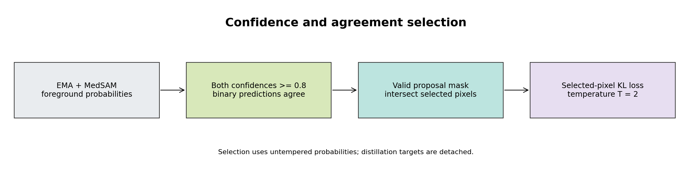

# Research methodology

## Objective

Train a compact, prompt-conditioned segmentation model using labeled and
unlabeled CT slices. The implementation separates supervision from annotations,
consistency with a weight-averaged model, and distillation from a larger medical
segmentation model. These objectives can be enabled independently for ablations.

The prediction target is a binary hemorrhage mask. Hemorrhage subtyping,
3D spatial modeling and diagnosis are outside the current implementation.

## Supervised learning

For labeled image `x` and binary reference `y`, the student predicts logits `z`.
The supervised objective is:

```text
p = sigmoid(z)
L_sup = BCEWithLogits(z, y) + 1 - mean_batch(Dice(p, y))
Dice(p, y) = (2 * sum(p*y) + epsilon) / (sum(p) + sum(y) + epsilon)
epsilon = 1e-6
```

Soft Dice is calculated per slice over channel and spatial dimensions. The
binary cross-entropy term uses PyTorch's default mean reduction. Ground-truth
masks provide one enclosing bounding box per labeled slice. Empty masks use
a whole-image box and still contribute negative supervised examples.

## Mean Teacher consistency

The EMA teacher starts as a frozen copy of the student. For an unlabeled slice:

1. Run the EMA teacher with a whole-image box.
2. Threshold its probability map at 0.5 to obtain an enclosing box.
3. Predict an EMA target from a weakly perturbed image using that box.
4. Predict the student output from a more strongly perturbed image using the same box.

Weak and strong perturbations add Gaussian intensity noise with standard
deviations 0.03 and 0.08, respectively, then clamp to `[0,1]`. No geometric
transforms are used, so image coordinates remain aligned.

```text
L_cons = mean((p_student - p_ema)^2)
theta_ema <- alpha * theta_ema + (1-alpha) * theta_student
alpha = min(0.99, 1 - 1/(step+1))
```

The update follows each optimizer step. Matching buffers are copied by name;
TinyViT evaluation-time attention-bias caches are rebuilt afterward.

## MedSAM distillation

The frozen MedSAM teacher processes the unperturbed unlabeled image with the
EMA-derived box. Distillation uses Bernoulli KL divergence rather than a
two-class softmax. At temperature `T=2`:

```text
q = sigmoid(z_medsam / T)
p = sigmoid(z_student / T)
KL(q || p) = q*log(q/p) + (1-q)*log((1-q)/(1-p))
L_kd = T^2 * sum(selection * KL) / max(sum(selection), 1)
```

Teacher outputs are detached. Targets are clamped away from zero and one for
stable logarithms. Slices with no foreground in the initial EMA proposal are
excluded from distillation, although consistency still applies to them.

In filtered mode, a pixel is selected only when both teachers have untempered
binary confidence of at least 0.8 and their thresholded predictions agree.
Confidence/agreement filtering is an optional extension. It can remove useful
small-lesion supervision or retain correlated mistakes; coverage and recall
must be examined alongside Dice.

## Combined objective and ablations



```text
L = L_sup + r(step) * (lambda_cons * L_cons + lambda_kd * L_kd)
r(step) = exp(-5 * (1 - clip(step/ramp_steps, 0, 1))^2)
```

The default coefficients are both 1 and the ramp length is 1,000 steps.
Real runs import SSL4MIS's sigmoid ramp-up utility. There is no hard warm-up
period: the initial ramp weight is approximately 0.0067.

| Mode | Consistency loss | Distillation loss | Confidence/agreement selection |
| --- | --- | --- | --- |
| `supervised` | no | no | no |
| `mean_teacher` | yes | no | no |
| `distill` | no | yes | no |
| `combined` | yes | yes | no |
| `filtered` | yes | yes | yes |

Distillation-only still uses EMA predictions for box proposals. Consequently,
`distill` versus `combined` compares adding the consistency objective, not
removing the EMA network. Compare all modes on identical patient manifests
and paired seeds. No medical-data ablation outcomes are available yet.

Implementation: [learning.py](../ich/learning.py), [train.py](../ich/train.py).
