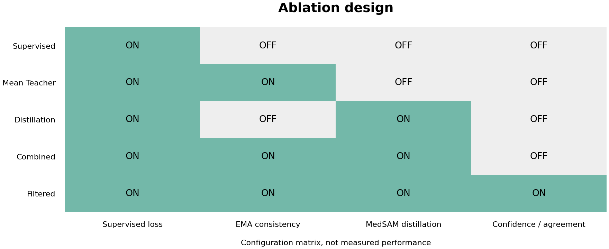

# Training details

## Defaults

| Setting | Value |
| --- | --- |
| Student | TinySAM |
| Mode | `filtered` |
| Input-size mode | `native` (1024 encoder input) |
| Optimizer | AdamW |
| Learning rate | `1e-4`, constant |
| Weight decay | PyTorch AdamW default, `0.01` |
| Steps | 10,000 |
| Labeled batch size | 2 |
| Unlabeled batch size | 2, when required |
| Validation interval | 100 steps and final step |
| EMA decay cap | 0.99 |
| Ramp length | 1,000 steps |
| Consistency / KD coefficients | 1.0 / 1.0 |
| Distillation temperature | 2.0 |
| Teacher confidence threshold | 0.8 |
| Prediction threshold | 0.5 |
| Random seed | 17 |
| Device | CPU; set `--device cuda` for GPU |

There is no mixed precision, gradient accumulation, learning-rate scheduler,
gradient clipping or automatic resume command. EMA decay, temperature, confidence
threshold and perturbation magnitudes currently reside in code, not CLI flags.

## Setup and launch

Run commands from the repository root in the installed environment:

```bash
pip install -e '.[sam,baselines,dev]'
python scripts/fetch_upstream.py
python -m ich.train --manifest data/manifest.csv --mode combined \
  --adaptation 512 --tiny-checkpoint checkpoints/tinysam.pth \
  --medsam-checkpoint checkpoints/medsam_vit_b.pth \
  --device cuda --steps 10000 --output runs/combined_512
```

Fetch scripts pin SSL4MIS and TinySAM revisions. Supply compatible pretrained
weights yourself; no checkpoint is downloaded automatically. Real runs require
SSL4MIS's ramp utility even for supervised baselines.

Baseline example:

```bash
python -m ich.train --manifest data/manifest.csv \
  --backbone efficientnet --mode mean_teacher \
  --device cuda --output runs/efficientnet_mt
```

## Step sequence

Each step draws one labeled batch and, where needed, one unlabeled batch from
independent repeating loaders. Compute the supervised loss, obtain frozen
teacher targets, add enabled ramp-weighted losses, backpropagate, take one
optimizer step and update EMA parameters and buffers. Validation uses the
student, not EMA predictions.

Python, NumPy and PyTorch seeds are set. Labeled/unlabeled shuffle generators
use `seed` and `seed+1`. GPU kernel determinism is not enforced, and the manifest
hash covers CSV contents rather than the bytes of every image or annotation.
Preserve source hashes and hardware/software versions for full reproducibility.

## Paired ablations



```bash
python scripts/ablations.py --steps 10000 --seeds 17 29 43 \
  --manifest data/manifest.csv --tiny-checkpoint checkpoints/tinysam.pth \
  --medsam-checkpoint checkpoints/medsam_vit_b.pth --device cuda
```

This executes five modes for each seed. Use the same manifest, checkpoint inputs,
adaptation setting, training budget and selection rule. The script saves all run
records in `summary.json`; it does not perform significance tests or automatically
calculate confidence intervals. Synthetic runs only check execution.

## Checkpoint selection and outputs

- `config.json`: CLI settings, manifest SHA-256 and PyTorch version.
- `history.jsonl`: step losses, consistency, KD and selected-pixel coverage.
- `best.pt`: student, EMA and optimizer states, step and CLI configuration.
- `validation.json`: patient metrics from the highest mean validation Dice.
- `test.json`: patient metrics after loading that selected student checkpoint.

Tied validation Dice does not replace the existing checkpoint. Validation runs
at the configured interval and the final step. The trainer evaluates test data
once at the end of each run. Validation data provide the checkpoint-selection
criterion; test outputs are separate from selection.

## Evaluation conventions

Predictions are thresholded at 0.5. Per-patient metrics aggregate pixel counts
across all listed slices, not averages of per-slice scores. The reported primary
summary is the arithmetic mean of patient Dice scores.

```text
Dice = 2*TP / (predicted_count + reference_count)
Precision = TP / predicted_count
Recall = TP / reference_count
RAVD = abs(predicted_count - reference_count) / reference_count
Signed relative volume error = (predicted_count - reference_count) / reference_count
```

When both masks are empty, Dice, precision and recall equal 1. With no predicted
foreground but positive reference, precision and recall equal 0. With an empty
reference and positive prediction, precision and recall equal 0. Volume measures
are `null` whenever reference foreground is empty. Physical voxel spacing is not
loaded; pixel-count volume interpretation assumes uniform voxel volume within
each patient's included slices.

Comparison panels are produced by [compare.py](../scripts/compare.py). Test
fixtures and interface checks are described in the [README](../README.md#verification).
